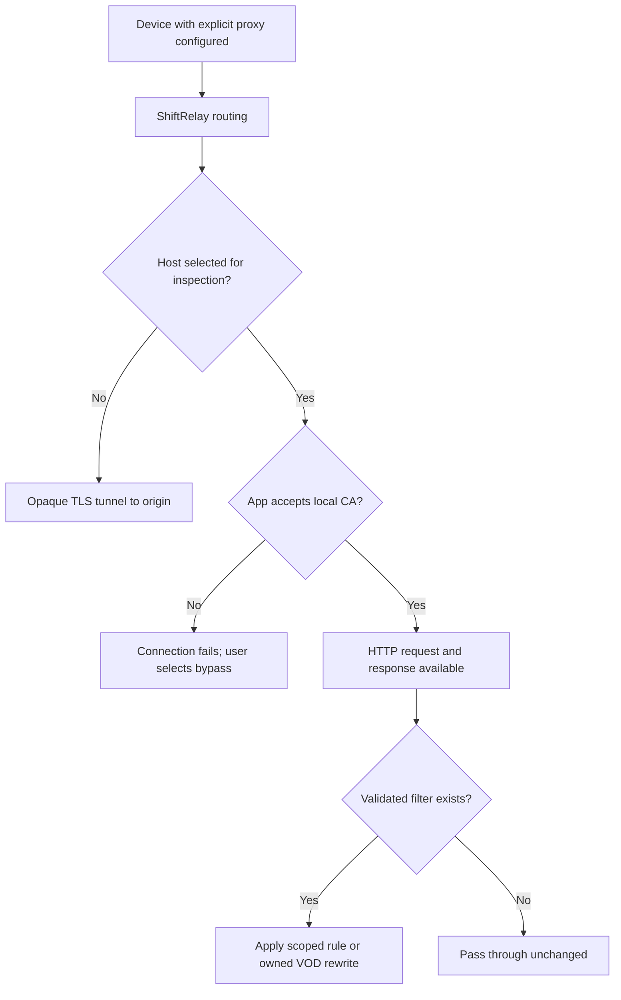

# Architecture and trust boundaries

The proxy creates two TLS sessions only for inspected connections. The app must accept the proxy's certificate; the proxy must validate the origin's certificate. Traffic sent back to a compatible app remains encrypted. Sending plaintext instead would fail when that app expects TLS.

TLS is distinct from media encryption. A decrypted HTTP response can still contain DRM-encrypted media. This release does not extract service credentials or DRM keys, change CDMs, patch apps or circumvent pinning.

The proxy container alone mounts the private CA volume. The portal only mounts a separate public certificate volume. Port 8787 provides public static pages/enrollment and an admin-authenticated status endpoint. There are no remote write endpoints for policy changes.

The optional GPL-3.0-only YouTube-on-TV bridge is a separate process and container. It stores pairing credentials and a recovery journal in its own private volume. The MIT portal only reads a validated, data-only public status file and exposes it through authenticated `/v1/native-status`; it does not import the bridge or read its private state. This control-service path does not route or decrypt the video stream.

The portal's consent session authorizes a temporary certificate download, not network access or automatic inspection. The device owner separately configures trust/proxy settings. It is not a captive portal and does not detect new Wi-Fi clients. Per-device proxy credentials and enforced admission are future work.

Global scope uses exact hosts with anchored TLS matching. The request filter uses exact host + path, excluding query strings. Block rules return HTTP 204 only for GET/HEAD. That behavior is not sufficient for all ad endpoints and can break players that expect a structured response. No production platform rules are included.

The HLS transformer accepts only clear, complete VOD playlists with ShiftRelay's custom owned-media ad markers and a tiny supported tag set. Live/event playlists, encryption keys, initialization maps, byte ranges and unknown tags are passed unchanged. The integration test proves byte-level rewriting, not visual playback correctness.

Media responses stream without frame decoding. Small eligible manifests are buffered with size limits. Aggregate counters are persisted without request paths, URLs, titles, tokens or payloads. mitmproxy still handles decrypted content in process memory on inspected hosts, and its runtime errors may contain connection information. This is a research service, not an audited privacy appliance.
